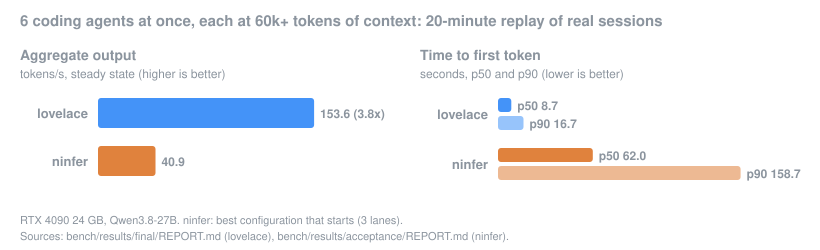
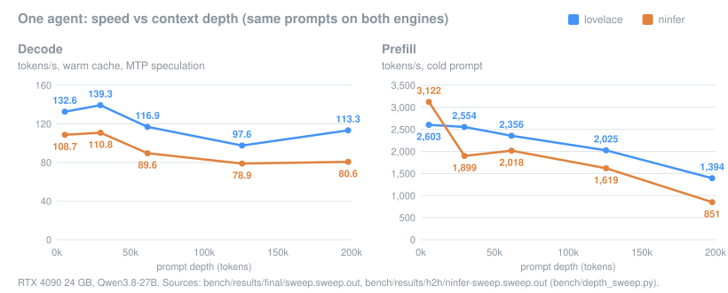
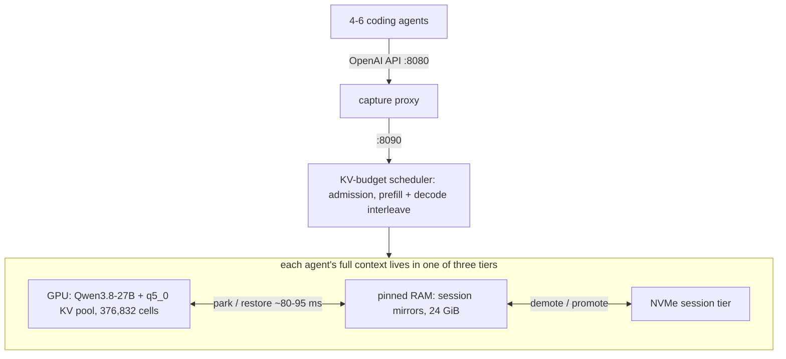
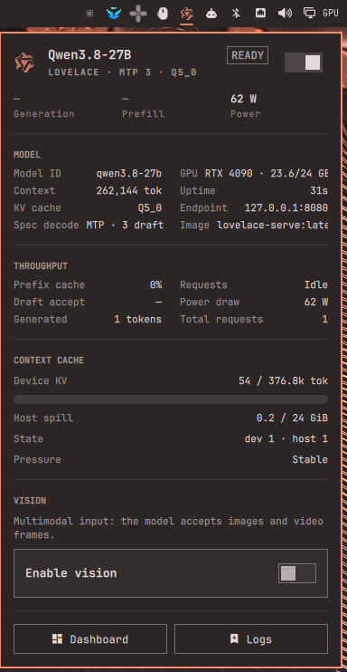

# lovelace

**One RTX 4090, one strong model, a whole team of coding agents.** lovelace serves Qwen3.8-27B to 4–6 concurrent
coding agents from a single 24 GB card, each agent with its own context of up to 262k tokens, without giving up
accuracy for speed. It pulls in concepts from llama, ninfer, and tensorflow runtimes, and optimizes everything for a 4090.

-4493f8)   [](LICENSE)



Against the setup it replaced (ninfer), on the same machine and the same replayed agent traffic, lovelace delivers
**3.8x the aggregate throughput**, first tokens **~7x sooner** at p50, and output **closer to the Q8_0 reference**
(KL 0.0171 vs 0.0282). All numbers on this page were measured on one box: RTX 4090 24 GB, Ryzen 9 9950X, 60 GB RAM,
Crucial T705 NVMe; see [Methodology](#methodology).

## Why

- **The most intelligence one 24 GB card can hold.** Weights and KV cache were picked by KL divergence against a
  Q8_0 reference on real agent transcripts, not by speed alone.
- **Many agents at once.** A KV-budget scheduler shares one GPU cache among 6 agents with no "context exceeded"
  errors; agents that pause are parked, not dropped.
- **262k context per agent.** Each agent keeps its whole history: in VRAM when active, in pinned RAM or on NVMe when
  parked, back on the GPU in ~80–95 ms.
- **Accuracy first.** Every kernel and scheduler change must pass a greedy-identity or KL-divergence gate before it
  merges.

## Results

### Quality: distance from the Q8_0 reference ([docs/quality-kld.md](docs/quality-kld.md))

Sparse top-64 KL divergence on 24 windows of recorded agent sessions at 32k–170k tokens of depth. Lower KL is
better; top-1 agree is how often the top token matches the reference.

| setup | KL mean | KL p99 | top-1 agree |
|---|---:|---:|---:|
| **lovelace: ShapeLearn IQ4_XS-3.84bpw + q5_0 KV** | **0.0171** | **0.178** | **95.67%** |
| ninfer: NInfer artifact + E8 `rk4v4-e8` KV | 0.0282 | 0.284 | 94.50% |
| ninfer, high-precision control (int8 KV) | 0.0227 | 0.231 | 95.02% |

The q5_0 KV cache adds KL 0.00155 over f16 KV, about 10% of the weight-quantization error, and none of the tested KV
types shows error growing with depth through 250k tokens.

### One agent: speed vs context depth ([bench/results/final/REPORT.md](bench/results/final/REPORT.md))



<details>
<summary>Table</summary>

| prompt tokens | cold prefill tok/s | ninfer | warm decode tok/s | ninfer |
|---:|---:|---:|---:|---:|
| 5,442 | 2,603 | **3,122** | **132.6** | 108.7 |
| 29,541 | **2,554** | 1,899 | **139.3** | 110.8 |
| 61,500 | **2,356** | 2,018 | **116.9** | 89.6 |
| 125,640 | **2,025** | 1,619 | **97.6** | 78.9 |
| 197,622 | **1,394** | 851 | **113.3** | 80.6 |

Same prompts on both engines (`bench/depth_sweep.py`); decode includes MTP speculation (3 draft tokens) on both.
</details>

### Many agents: 20-minute replays of real sessions ([bench/results/final/REPORT.md](bench/results/final/REPORT.md))

| run | steady aggregate tok/s | TTFT p50 / p90 (s) | median depth | errors |
|---|---:|---:|---:|---:|
| **6 agents, 60k+ tokens each** | **153.6** | **8.7 / 16.7** | 78.7k | 0 |
| ninfer, same workload (best config that starts: 3 lanes) | 40.9 | 62.0 / 158.7 | 63.2k | 0 |
| 6 agents, 150k+ tokens each (more than the GPU pool holds) | 66.3 | 33.3 / 108.3 | 161.6k | 0 |
| 3 agents past 200k tokens | 113.9 | 1.0 / 7.5 | 74.9k | 0 |

ninfer row: [bench/results/acceptance/REPORT.md](bench/results/acceptance/REPORT.md) and
[h2h/ninfer-3lane-6a.replay.out](bench/results/h2h/ninfer-3lane-6a.replay.out).

### Context

- **262,144 tokens per agent**; the 6 agents share a 376,832-cell q5_0 KV pool on the GPU.
- In the 3-agent run, 71 turns ran at ≥ 200k tokens across 4 sessions (max 220,486), with a median 208,650 tokens
  served from cache and 0 errors ([final/REPORT.md](bench/results/final/REPORT.md)).
- Switching the GPU to another agent's 1.5 GiB session takes ~80–95 ms of critical path
  ([restore-latency/REPORT.md](bench/results/restore-latency/REPORT.md)).

## How it works



lovelace is [llama.cpp](https://github.com/ggml-org/llama.cpp) (b11223, in `engine/`) plus:

- **FlashAttention that reads the q5_0 cache directly** on sm_89, with int8 tensor-core QK and no f16 copy, for
  decode, speculative verify and prefill ([design](docs/design/fattn-quantized-kv.md),
  [prefill-depth](bench/results/prefill-depth/REPORT.md): 126k cold prefill 1,126 → 1,730 tok/s with 6 lanes).
- **ReplaySSM rollback** for the model's Gated-DeltaNet layers: speculative verify records its inputs and folds only
  the accepted tokens, bit-exact, instead of snapshotting recurrent state per draft token
  ([design](docs/design/replayssm-llamacpp.md)).
- **KV-budget scheduler**: admits work against real cache capacity, interleaves prefill chunks with decode, and parks
  idle agents instead of failing requests.
- **Per-agent session store**: an append-only mirror of every session in pinned RAM, synced after each request,
  demoted to NVMe instead of dropped ([design](docs/design/session-store.md)).
- **Each sequence attends only to its own cells** in the shared cache: a 125k prefill runs at 1,741 tok/s with a 148k
  session resident vs 960 before ([resident-cost](bench/results/resident-cost/REPORT.md)).
- **Cheaper decode steps**: the attention mask is built on the GPU (6-agent step 56.4 → 52.1 ms) and the MTP draft
  head predicts over a 32k-token vocabulary (+3.9% summed decode) ([step-costs](bench/results/step-costs/REPORT.md)).
- **Observability**: `/telemetry`, an `/events` stream, a JSONL request log, NVML energy per prefill/decode, and a
  web dashboard on the API port ([docs/observability.md](docs/observability.md), [docs/dashboard.md](docs/dashboard.md)).

## Quick start

Needs Linux, Docker with the NVIDIA container toolkit, an RTX 4090, and [Bun](https://bun.sh) for the dashboard.

```sh
# 1. weights (ShapeLearn IQ4_XS, 13.1 GB, MTP head embedded)
hf download byteshape/Qwen3.8-27B-GGUF Qwen3.8-27B-IQ4_XS-3.84bpw.gguf --local-dir ~/models/byteshape

# 2. build images and the engine (CUDA 13.1, sm_89)
docker build -f deploy/devel.Dockerfile   -t lovelace-engine-devel:cuda13.1   deploy
docker build -f deploy/engines.Dockerfile -t lovelace-engine-runtime:cuda13.1 deploy
deploy/build-engine.sh llama-server
(cd apps/web && bun install && bun run build)
docker build -f deploy/serve.Dockerfile -t lovelace-serve:latest .

# 3. run
deploy/serve.sh balanced        # also: quality, vision; status | logs | stop
```

- **Endpoint**: `http://127.0.0.1:8080/v1` (OpenAI-compatible, model `qwen3.8-27b`) through the capture proxy; the
  engine itself listens on `:8090`. The proxy **stores every request body** under
  `~/.local/state/lovelace/lib/captures/` for later replay; point clients at `:8090` if you don't want that.
- **Dashboard**: http://127.0.0.1:8080/
- **RAM safety**: the engine container is capped at 34 GiB (`--memory 34g`) and the pinned session arena is 24 GiB
  (`--session-ram 24576`). Pinned memory can't be swapped; before these limits, two long benchmark runs pushed the
  host out of memory and the kernel killed the desktop ([docs/STATUS.md](docs/STATUS.md)). Now an overrun restarts the
  engine and sessions survive on disk.

Profiles, state directories, the GPU lock and the benchmark scripts: [docs/README-dev.md](docs/README-dev.md).

## Desktop monitor (Omarchy)



An [Omarchy](https://omarchy.org) bar widget in [integrations/omarchy](integrations/omarchy): the model as headline
with a runtime tag (runtime, spec method and draft tokens, KV type) read from `/v1/models` and `/telemetry`, live
throughput, GPU and context-cache state, a start/stop switch driving `deploy/serve.sh`, the vision profile toggle, and
links to the dashboard and logs. `omarchy plugin add` only installs repository roots, so install it from a checkout:

```sh
integrations/omarchy/install.sh --enable      # --uninstall to remove
```

The script links the plugin folder into `~/.config/omarchy/plugins/keylimesoda.lovelace` and its helper to
`~/.local/bin/lovelace-monitor`; `git pull` updates it. Details and the ninfer fallback engine:
[integrations/omarchy/README.md](integrations/omarchy/README.md).

<br clear="right">

## Limits and status

Tracked against [docs/CHARTER.md](docs/CHARTER.md) (acceptance table) and [docs/STATUS.md](docs/STATUS.md).

- **Deep multi-agent throughput is PARTIAL (charter C3).** At 6 agents x 150k+ tokens the aggregate is 66.3 tok/s,
  43% of the 60k figure against a 70% target (it was 25.0). Only ~2 sessions of that depth fit the GPU pool at once,
  and the 24 GiB RAM tier cycles through NVMe (698 demotions). Work is ongoing.
- **Short cold prompts prefill slower than ninfer**: 2,603 vs 3,122 tok/s at ~5k tokens; lovelace is faster from
  30k up.
- **Quality is measured against Q8_0, not BF16** (charter A2: proxy only).
- **One GPU, one model, one machine.** Kernels, pool sizes and memory limits are tuned for this RTX 4090 box;
  other hardware is untested.

## Methodology

- **Real traffic.** Multi-agent numbers replay recorded [oh-my-pi](https://github.com/can1357/oh-my-pi) coding
  sessions against the server (`bench/replay/`, `bench/run_replay.sh`): 20-minute timed windows, steady state after
  warm-up. The session transcripts are private and never committed.
- **Same workload for both engines.** `bench/h2h.sh` runs lovelace and ninfer on identical prompts; ninfer is given
  the best configuration that starts. Single-stream: `bench/depth_sweep.py`.
- **Quality gate.** `eval/kld/` scores sparse top-64 KL against Q8_0 weights with f16 KV on 32k–250k-token windows;
  a change that moves numerics must stay within the gate (e.g. the prefill kernel: 0.01721 ≤ 0.01757,
  [prefill-depth](bench/results/prefill-depth/REPORT.md)).
- **Greedy identity.** `bench/greedy_gate.sh` compares greedy outputs token for token between builds, with and
  without speculation; op-level suites run through `bench/op_gates.sh`.
- **One GPU job at a time.** Every measurement takes `deploy/gpu-lock.sh`, with production stopped.
- **Scripts only.** `bench/acceptance.sh` and `bench/final_acceptance.sh` produce the reports; raw outputs sit next
  to each `bench/results/*/REPORT.md`. Charts: `python3 docs/make_charts.py` regenerates `docs/img/` from them.

## Credits

lovelace stands on other people's work.

- **[llama.cpp / ggml](https://github.com/ggml-org/llama.cpp)** (ggml-org, MIT): the whole base engine, imported
  as the `engine/` subtree at b11223. The quantized-KV FlashAttention kernels are built on ggml-cuda's
  FlashAttention and mma infrastructure (`fattn-common.cuh`), and DFlash/MTP speculative decoding, the server and the
  GGUF tooling are upstream's.
- **[Qwen team](https://huggingface.co/Qwen)**: Qwen3.8-27B, its multi-token-prediction head (our draft model), and
  the chat template in `bench/replay/corpus/`.
- **[ByteShape ShapeLearn](https://huggingface.co/byteshape/Qwen3.8-27B-GGUF)**: the production weights,
  `Qwen3.8-27B-IQ4_XS-3.84bpw` (and the IQ3_S-3.23bpw quant we measured).
  **[ggml-org/Qwen3.8-27B-GGUF](https://huggingface.co/ggml-org/Qwen3.8-27B-GGUF)**: the Q8_0 quality reference
  and the vision projector.
- **The NInfer family**, the previous engine on this box: [Neroued/ninfer](https://github.com/Neroued/ninfer)
  (original engine; its ReplaySSM design is what `docs/design/replayssm-llamacpp.md` ports),
  [Don-Chad/ninfer-3090](https://github.com/Don-Chad/ninfer-3090), and
  [sergiuszm/ninfer-4090](https://github.com/sergiuszm/ninfer-4090) (the sm_89 port and incumbent benchmark,
  with the [neroued/Qwen3.8-27B-NInfer](https://huggingface.co/neroued/Qwen3.8-27B-NInfer) artifact).
- **[tensorninja/ninfer-4090](https://github.com/tensorninja/ninfer-4090)** (Apache-2.0): the observability design
  (live telemetry snapshot, SSE event stream, JSONL request records, board-energy attribution) re-implemented here
  for llama-server, and the web dashboard: `apps/web` is derived from its `apps/web`
  (see [THIRD_PARTY_NOTICES.md](THIRD_PARTY_NOTICES.md)).
- **[keylimesoda/ninfer-4090-lin-hybrid](https://github.com/keylimesoda/ninfer-4090-lin-hybrid)**: our earlier
  hybrid of sergiuszm/ninfer-4090 with the tensorninja observability layer. The dashboard was ported from it, and it
  is the "ninfer" measured in every comparison here (image `ninfer-4090:hybrid`, `bench/h2h.sh`).
- **Evaluated, not adopted** (thank you for making them available):
  - [z-lab DFlash2](https://github.com/z-lab/dflash) drafts
    ([z-lab/Qwen3.8-27B-DFlash2](https://huggingface.co/z-lab/Qwen3.8-27B-DFlash2), GGUF by
    [incoai](https://huggingface.co/incoai/Qwen3.8-27B-DFlash2-GGUF)): acceptance 0.27 vs 0.55 for the built-in MTP
    head on agent traffic, so MTP was kept ([CHARTER](docs/CHARTER.md) D1).
  - ninfer's E8 lattice KV (`rk4v4-e8`): ~28% less KV memory, but it adds 0.0055 KL over its int8 control vs 0.0008
    for q5_0 over f16, so it wasn't ported ([quality-kld](docs/quality-kld.md)).
  - [beellama.cpp](https://github.com/Anbeeld/beellama.cpp) with KVarN KV: part of the engine bake-off
    (`bench/bakeoff/run_matrix.sh`); KVarN quality was not measured ([CHARTER](docs/CHARTER.md) D2).
  - [ISTA-DASLab GSQ-RCO IQ3_S](https://huggingface.co/ISTA-DASLab/Qwen3.8-27B-GSQ-RCO-GGUF): 1 GB smaller, 1.33x
    the KL ([quality-kld](docs/quality-kld.md)).
- Dashboard built with [React](https://react.dev), [Apache ECharts](https://echarts.apache.org),
  [Vite](https://vite.dev) and [Bun](https://bun.sh); images on [NVIDIA CUDA](https://hub.docker.com/r/nvidia/cuda).

## License

lovelace's own code is under the [MIT License](LICENSE). Third-party components keep their licenses:
`engine/` is llama.cpp under MIT ([engine/LICENSE](engine/LICENSE)), and `apps/web` contains Apache-2.0 code from
ninfer-4090. Details: [THIRD_PARTY_NOTICES.md](THIRD_PARTY_NOTICES.md).
